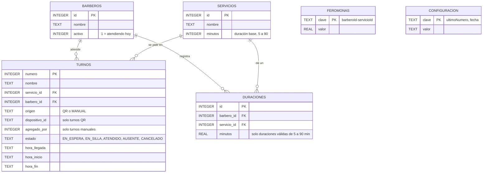

# Base de datos de CuántoFalta

## Por qué una base de datos pequeña

En las entregas anteriores los datos vivían en memoria: si el portátil de la barbería se apagaba o se cerraba la ventana, se perdían la fila y todo lo que el sistema había aprendido de cada barbero (duraciones reales y feromonas). Para la versión final se agregó una base de datos **SQLite**.

**Decisión:** se usa el módulo `node:sqlite` que ya viene incluido en Node.js 22. No hay que instalar MySQL, PostgreSQL ni ningún programa adicional, y toda la información queda en un solo archivo (`datos/cuantofalta.db`) junto al programa. Esto respeta la restricción del equipo de no poder instalar programas en los equipos de la universidad.

## Cómo se conecta con el resto del código

```
FilaService / Administracion  ──>  repositorio.js  ──>  baseDatos.js  ──>  datos/cuantofalta.db
      (lógica del negocio)        (listas en memoria)     (SQL)               (archivo SQLite)
```

- `repositorio.js` sigue siendo el **único** archivo que guarda información. El resto del sistema no sabe que existe SQLite.
- Al encender el servidor, `repositorio.conectar()` carga las tablas a las listas en memoria.
- Después de cada acción (tomar turno, Siguiente, No está, Deshacer, cambios del dueño) se llama a `repositorio.guardar()`, que copia todo a SQLite dentro de una **transacción** (se guarda todo o nada).
- Si el servidor se enciende un día distinto, la fila del día anterior se borra automáticamente y la numeración vuelve a 1. Las duraciones y las feromonas se conservan.
- Las pruebas automáticas no se conectan a la base de datos (trabajan en memoria), salvo `basedatos.test.js`, que usa un archivo temporal.

## Modelo entidad-relación



## Tablas

| Tabla | Qué guarda | Para qué se usa |
|---|---|---|
| `barberos` | Barberos de la barbería y si están atendiendo | Listas de las pantallas y asignación de turnos |
| `servicios` | Servicios y su duración base | Cálculo de espera mientras no hay historial |
| `turnos` | Turnos del día con su estado y horas | La fila de cada barbero |
| `duraciones` | Cuánto tardó realmente cada servicio | Promedio de las últimas 10 duraciones de cada barbero |
| `feromonas` | Rastro del algoritmo de colonia de hormigas | Opción "El que esté libre primero" |
| `configuracion` | Último número de turno y fecha de la jornada | Numeración y cierre automático del día |

## Ver la base de datos

El archivo `datos/cuantofalta.db` se puede abrir con [DB Browser for SQLite](https://sqlitebrowser.org/) o en línea con [sqliteviewer.app](https://sqliteviewer.app/) (arrastrando el archivo). Para empezar de cero basta con apagar el servidor y borrar la carpeta `datos`.
